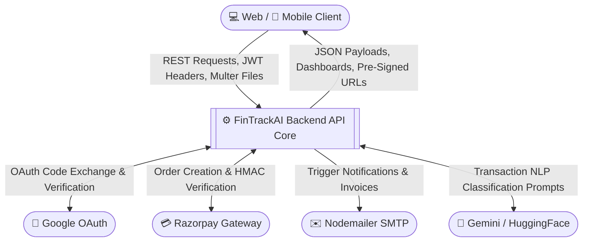
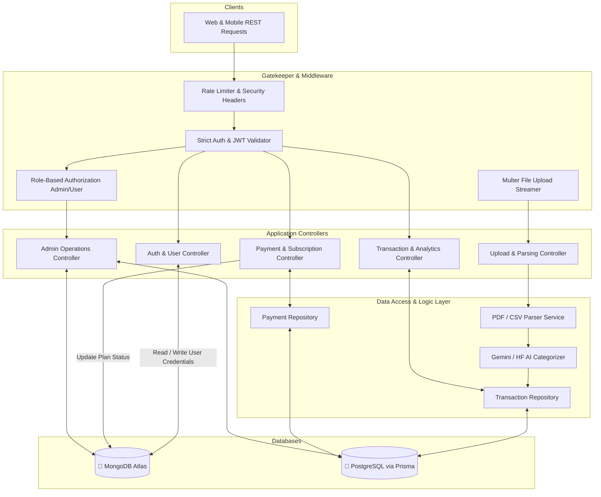
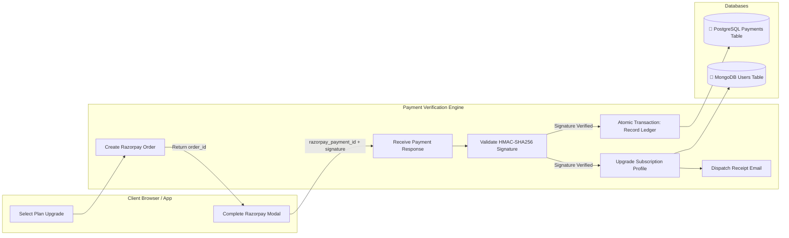

<div align="center">

# 🏦 FinTrackAI - High-Performance Backend Core
### Distributed Polyglot Financial Ingestion & Analytics REST Engine

[](https://nodejs.org/)
[](https://expressjs.com/)
[](https://www.postgresql.org/)
[](https://www.prisma.io/)
[](https://www.mongodb.com/)
[](https://razorpay.com/)

<p align="center">
  <b>The mission-critical backbone of FinTrackAI.</b><br/>
  Engineered with polyglot persistence (PostgreSQL for ACID financial ledgers + MongoDB for high-velocity user identities), streaming bank statement parsing, cryptographic billing webhooks, and AI pipeline orchestration.
</p>

</div>

---

## 🏛️ Polyglot Architecture & Domain Matrix

FinTrackAI separates relational financial obligations from dynamic user document stores:

```
                  ┌──────────────────────────────┐
                  │    Express API Application   │
                  └──────────────┬───────────────┘
                                 │
                 ┌───────────────┴───────────────┐
                 ▼                               ▼
    ┌─────────────────────────┐     ┌─────────────────────────┐
    │  Prisma Repository DAL  │     │   Mongoose ODM Layer    │
    └────────────┬────────────┘     └────────────┬────────────┘
                 ▼                               ▼
    ┌─────────────────────────┐     ┌─────────────────────────┐
    │  🐘 PostgreSQL Ledger   │     │   🍃 MongoDB Atlas      │
    │  - Transactions (ACID)  │     │  - User Accounts & Auth │
    │  - Subscription Payments│     │  - Contacts & Inquiries │
    │  - Composite B-Tree Idx │     │  - Audit System Logs    │
    └─────────────────────────┘     └─────────────────────────┘
```

---

## 🗺️ Backend Data Flow Diagrams (DFD)

### Level 0 DFD: Backend Service Boundary



---

### Level 1 DFD: Internal Backend Flow & Data Stores



---

### Level 2 DFD: Payment & Subscription Ledger Subsystem



---

## 🛠️ Tech Stack & Dependencies

| Layer | Library / Tool | Purpose |
| :--- | :--- | :--- |
| **Runtime & Framework** | Node.js `>=18.x`, Express `4.18.x` | RESTful API server |
| **Relational ORM** | Prisma `5.22.x` | PostgreSQL schema migrations & queries |
| **Document ODM** | Mongoose `8.x` | MongoDB connection & document models |
| **Document Processing** | `pdf-parse`, `csv-parser`, `multer` | Multi-format bank statement OCR & stream parsing |
| **Security & Auth** | `jsonwebtoken`, `bcryptjs`, `passport-google-oauth20` | Dual JWT & OAuth 2.0 implementation |
| **Payments** | `razorpay`, `crypto` | Order generation & cryptographic webhook verification |
| **Notifications** | `nodemailer` | Automated HTML transactional emails |

---

## 📁 Directory Structure

```
backend/
├── config/            # DB connectors (MongoDB, Prisma, Passport, Mailer)
├── controllers/       # Controller business logic (Auth, User, Admin, Payment)
├── middleware/        # Strict authentication, RBAC, Multer file filters
├── models/            # Mongoose schemas (User, Contact, Newsletter)
├── prisma/            # Relational PostgreSQL schema (schema.prisma) & migrations
├── repositories/      # Prisma Data Access Layer for Transactions and Payments
├── routes/            # Express router definitions
├── utils/             # PDF parser, CSV parser, AI category mapper
└── server.js          # Main application bootstrapper
```

---

## ⚡ Quick Start

```bash
cd backend
npm install

# 1. Environment configuration
cp .env.example .env

# 2. Database migrations (PostgreSQL)
npx prisma generate
npx prisma db push

# 3. Start development server
npm run dev
```

*Server will initialize on `http://localhost:8000`.*
