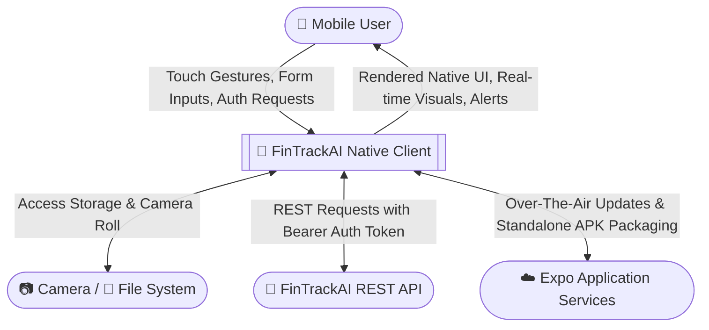
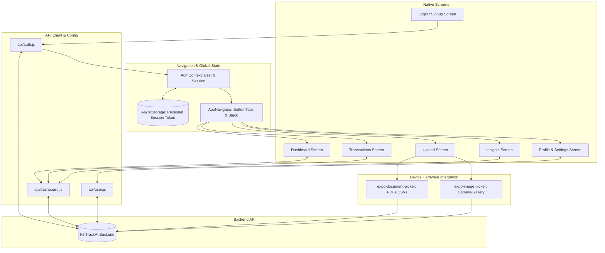
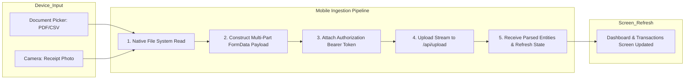

<div align="center">

# 📱 FinTrackAI - Native Mobile App
### Cross-Platform React Native & Expo Financial Intelligence

[](https://reactnative.dev/)
[](https://expo.dev/)
[](https://reactnavigation.org/)
[](https://github.com/varunjoshi84/FintrackAI/releases/latest)

<p align="center">
  <b>Enterprise personal finance in the palm of your hand.</b><br/>
  Native iOS & Android mobile application engineered with React Native and Expo SDK 54, offering seamless session recovery, instant statement and camera-receipt uploads, real-time spending telemetry, and offline-resilient caching.
</p>

[🚀 Download Production Standalone APK](https://github.com/varunjoshi84/FintrackAI/releases/latest)

</div>

---

## ✨ Mobile Highlights

- ⚡ **Native Performance**: Ultra-responsive screens built on React Native 0.81 with Hermes engine.
- 📸 **Receipt & Document Scanning**: Take photos of physical receipts via `expo-image-picker` or pick bank statements via `expo-document-picker`.
- 📊 **Vector Spending Visualizations**: Smooth Bézier curves and donut charts powered by `react-native-chart-kit` and `react-native-svg`.
- 🔐 **Secure Native Storage**: Session tokens and credentials preserved across reboots using `@react-native-async-storage/async-storage`.
- 📦 **Automated Cloud Builds**: Production standalone `.apk` builds streamlined via Expo Application Services (EAS).

---

## 🗺️ Mobile App Data Flow Diagrams (DFD)

### Level 0 DFD: Mobile App Boundary



---

### Level 1 DFD: Internal React Native Architecture & State Management



---

### Level 2 DFD: Mobile Receipt / Statement Upload Subsystem



---

## 🛠️ Tech Stack & Dependencies

| Tool | Version | Description |
| :--- | :--- | :--- |
| **Framework** | React Native `0.81.0` | Mobile application core |
| **Tooling** | Expo SDK `~54.0.0` | Development toolkit and native modules |
| **Navigation** | React Navigation `^7.0.0` | Native Stack and Bottom Tabs |
| **Storage** | Async Storage `2.2.0` | Asynchronous, unencrypted, persistent key-value storage |
| **Visuals** | `react-native-chart-kit` & `react-native-svg` | Smooth chart drawing & SVG icons |
| **Device APIs** | `expo-document-picker`, `expo-image-picker` | File picking and camera integration |
| **Build System** | Expo EAS CLI | Cloud compilation to `.apk` & `.aab` |

---

## 📁 Directory Structure

```
mobile/
├── src/
│   ├── api/             # Network requests (auth, dashboard, user)
│   ├── context/         # AuthContext with session restoration
│   ├── navigation/      # Native AppNavigator routing
│   ├── screens/         # Dashboard, Transactions, Upload, Insights, Profile
│   └── theme/           # Color tokens & design constants
├── App.js               # Entry point wrapped with AuthProvider
├── app.json             # Manifest configuration
├── eas.json             # EAS cloud build configurations (Preview APK)
└── package.json
```

---

## ⚡ Quick Start & Development

```bash
cd mobile
npm install

# Start development packager
npm start
```

- Press `a` for Android Emulator
- Press `i` for iOS Simulator
- Scan QR code using the **Expo Go** app on your phone.

---

## 📦 Building Standalone APK

The mobile app includes configured EAS profiles in `eas.json`. To compile a new standalone Android `.apk`:

```bash
eas build -p android --profile preview
```

Or download the latest pre-compiled build:

🚀 **[Download Latest FinTrackAI Android APK](https://github.com/varunjoshi84/FintrackAI/releases/latest)**
