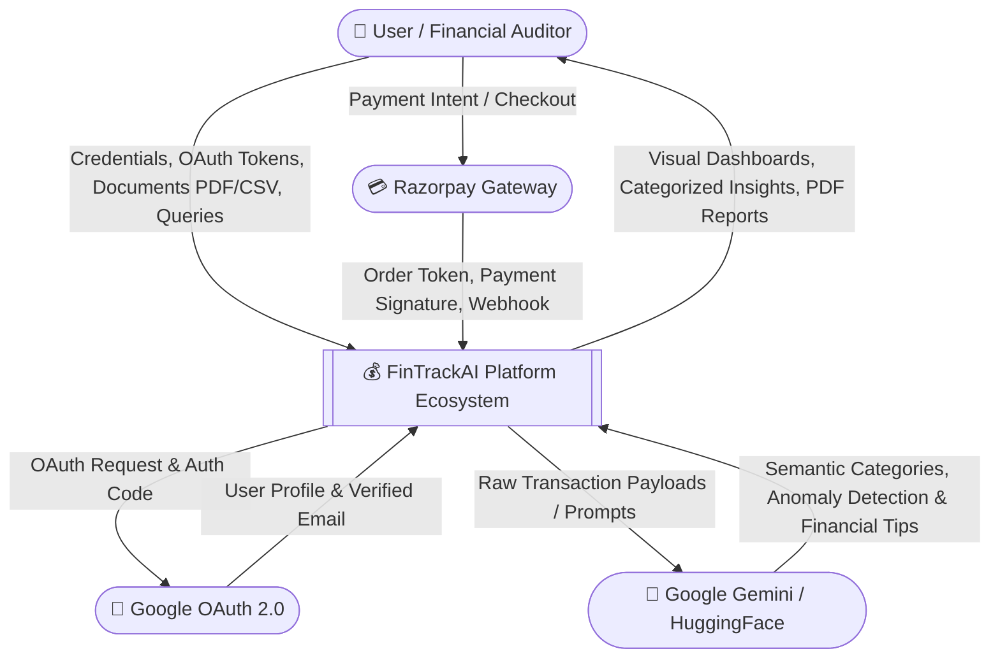
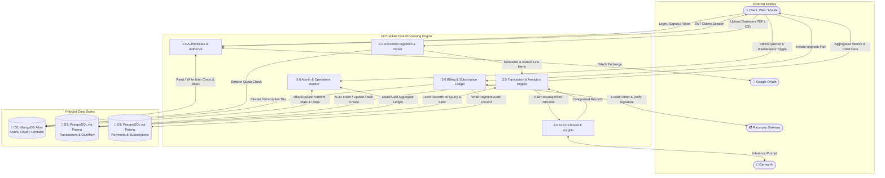

<div align="center">

# 💎 FinTrackAI
### Next-Gen Autonomous Financial Intelligence & Polyglot Analytics Platform

[](https://github.com/varunjoshi84/FintrackAI/releases/latest)
[](https://nodejs.org/)
[](https://expressjs.com/)
[](https://react.dev/)
[](https://reactnative.dev/)
[](https://expo.dev/)
[](https://tailwindcss.com/)
[](https://www.postgresql.org/)
[](https://www.prisma.io/)
[](https://www.mongodb.com/)
[](https://opensource.org/licenses/MIT)

<p align="center">
  <b>A unified, enterprise-grade personal & business financial operating system.</b><br/>
  Featuring polyglot persistence, automated bank statement OCR/parsing (PDF/CSV), predictive machine learning categorizations (Google Gemini + Hugging Face), real-time interactive cash-flow dashboards, tiered Razorpay billing, and cross-platform native sync across Web, iOS, and Android.
</p>

[📱 Download Android APK](https://github.com/varunjoshi84/FintrackAI/releases/latest) • [🌐 Web Client](web/README.md) • [🏦 Backend Core](backend/README.md) • [📱 Mobile App](mobile/README.md)

</div>

---

## 🌟 Key Highlights

<table>
<tr>
<td width="50%">

### ⚡ Financial Superpowers
- **Automated Statement Ingestion**: Parse complex bank statements (PDFs, CSVs) with instant normalization and deduplication.
- **AI-Driven Transaction Categorization**: Powered by Gemini & Hugging Face NLP models to auto-tag expenses into groceries, utilities, investments, lifestyle, etc.
- **Real-Time Financial Intelligence**: Continuous calculation of net-worth velocity, burn rates, savings indices, and anomaly alerts.

</td>
<td width="50%">

### 🛡️ Enterprise Engineering
- **Polyglot Persistence Architecture**: PostgreSQL with Prisma for ACID-compliant financial transactions and subscriptions; MongoDB for elastic identity, preferences, and communications.
- **Bi-Directional Zero-Friction APIs**: Canonical entity translation layer serving identical JSON schemas to web and native clients.
- **Razorpay Subscriptions**: Tiered subscription entitlement with automated cryptographic HMAC-SHA256 signature verification.

</td>
</tr>
</table>

---

## 🗺️ System Data Flow Diagrams (DFD)

### Level 0 DFD: Context Diagram
The overarching boundary of FinTrackAI interacting with external entities.



---

### Level 1 DFD: System Data Flow Breakdown



---

### Level 2 DFD: Bank Statement Parsing & AI Categorization Subsystem

```mermaid
flowchart LR
    subgraph Inputs
        DOC[/📄 PDF / CSV File/]
        UID[/🔑 User Session Context/]
    end

    subgraph Parser_Pipeline [Document Pipeline]
        P2_1[2.1 Validate File Type & Size]
        P2_2[2.2 Quota Enforcement Gate]
        P2_3[2.3 Text Extraction & Parsing<br/>pdf-parse / csv-parser]
        P2_4[2.4 Regex Date/Amount Sanitizer]
    end

    subgraph AI_Pipeline [AI Classification Subsystem]
        P4_1[4.1 Rule-Based Fast Matcher]
        P4_2[4.2 LLM Zero-Shot Classifier<br/>Gemini / HuggingFace]
        P4_3[4.3 Spend Anomaly & Tip Generator]
    end

    subgraph Storage [PostgreSQL Ledger]
        DB[(🐘 Prisma Transactions Table)]
    end

    DOC & UID --> P2_1
    P2_1 --> P2_2
    P2_2 --> P2_3
    P2_3 --> P2_4
    P2_4 --> P4_1
    P4_1 -->|Uncertain Labels| P4_2
    P4_1 -->|High Confidence| P4_3
    P4_2 --> P4_3
    P4_3 -->|Indexed Bulk Insert| DB
```



---

## 🏛️ Monorepo Blueprint

```
FintrackAI/
│
├── 📁 backend/                # Polyglot REST API & Document AI Microservice
│   ├── 📁 prisma/             # Relational schema (PostgreSQL) + Migration History
│   ├── 📁 repositories/       # High-performance Prisma Data Access Layer (DAL)
│   ├── 📁 routes/             # API routes (Auth, Upload, Transactions, Analytics, Admin)
│   ├── 📁 middleware/         # JWT Verification, Strict RBAC, Multer File Filter
│   └── 📄 README.md           # Dedicated Backend Architecture Guide & DFD
│
├── 📁 web/                    # Responsive React 19 SPA
│   ├── 📁 src/api/            # Centralized Axios client & API gateways
│   ├── 📁 src/components/     # Modular glassmorphism UI components & Chart.js widgets
│   ├── 📁 src/pages/          # Dynamic views (Dashboard, Ingestion, Insights, Admin)
│   └── 📄 README.md           # Dedicated Web Client Architecture Guide & DFD
│
├── 📁 mobile/                 # Cross-Platform React Native App (iOS & Android)
│   ├── 📁 src/screens/        # Native mobile views (Dashboard, Upload, Cards, Profile)
│   ├── 📁 src/navigation/     # Native Stack + Bottom Tabs routing
│   ├── 📁 src/context/        # Global auth & session state provider
│   ├── 📄 eas.json            # EAS cloud build & preview profiles (Standalone APK)
│   └── 📄 README.md           # Dedicated Mobile App Architecture Guide & DFD
│
├── 📄 docker-compose.yml      # Orchestration for local development
└── 📄 readme.MD               # Master System Overview
```

---

## 💎 Technology Comparison Matrix

| Capability | Backend Architecture | Web Client (Vite) | Mobile App (Expo) |
| :--- | :--- | :--- | :--- |
| **Core Runtime** | Node.js 18.x + Express 4.18 | React 19.1 + Vite 7 | React Native 0.81 + Expo SDK 54 |
| **Language** | JavaScript (ESM / CommonJS) | JavaScript (JSX) | JavaScript (JSX) |
| **Persistence / Cache** | **Polyglot**: PostgreSQL 15+ & MongoDB Atlas | Browser LocalStorage / Memory | Encrypted AsyncStorage |
| **Data Access / ORM** | Prisma 5.22 + Mongoose 8.x | Axios REST Client | Custom Native Fetch Client |
| **Visual Styling** | N/A | Tailwind CSS v4 + GSAP Smooth UX | Native StyleSheet + Ionicons |
| **Data Analytics** | SQL Window Functions & Aggregations | Chart.js 4.5 Interactive Canvas | React Native Chart Kit + SVG |
| **Auth System** | Dual JWT + Passport Google OAuth 2.0 | Bearer Interceptors & Protected Routes | Bearer Auth Context & Native Guards |
| **Document Ingestion** | Multer + `pdf-parse` + `csv-parser` | Drag-and-Drop Native HTML5 UI | `expo-document-picker` + Camera |
| **Distribution / Deploy** | Render / Docker / Vercel | Vercel / Netlify Edge | EAS Build (Production APK / TestFlight) |

---

## ⚡ Quick Start & Development Setup

### 1. Prerequisites
- **Node.js** `>= 18.x`
- **npm** `>= 9.x`
- **PostgreSQL Database** (Local instance or Supabase/Neon cloud instance)
- **MongoDB Atlas** (Cluster connection string)

---

### 2. Backend API Setup
```bash
cd backend
npm install

# Configure environment variables
cp .env.example .env

# Generate Prisma client & push relational schema
npx prisma generate
npx prisma db push

# Start development API server
npm run dev
# -> Live at http://localhost:8000
```

---

### 3. Web Client Setup
```bash
cd web
npm install

# Start Vite dev server
npm run dev
# -> Live at http://localhost:5173
```

---

### 4. Mobile Client Setup (Android / iOS)
```bash
cd mobile
npm install

# Start Expo development server
npm start
```
- Press `a` for Android Emulator
- Press `i` for iOS Simulator
- Scan QR code via **Expo Go** on physical devices.

---

## 📦 Releases & Standalone Android APK

You can download the production-ready standalone Android APK directly:

🚀 **[Download Latest FinTrackAI Android APK](https://github.com/varunjoshi84/FintrackAI/releases/latest)**

---

## 🛡️ Security & Privacy Guardrails

- **Cryptographic Hashing**: Passwords stored via `bcryptjs` with salt round factor 12.
- **Strict Authorization**: Multi-tiered role-based security protecting sensitive endpoints.
- **Payment Verification**: Webhook and order callbacks verified using cryptographic HMAC SHA256 signatures before provisioning subscription capabilities.
- **Sanitized SQL Queries**: All queries parameterized natively through Prisma ORM, mitigating SQL injection vulnerabilities.

---

## 🤝 Contributing

Contributions make the open-source community thrive!
1. Fork the Project
2. Create your Feature Branch (`git checkout -b feature/EpicFeature`)
3. Commit your Changes (`git commit -m 'feat: Add some EpicFeature'`)
4. Push to the Branch (`git push origin feature/EpicFeature`)
5. Open a Pull Request

---

<div align="center">
  <sub>Built with ❤️ by <a href="https://github.com/varunjoshi84">Varun Joshi</a> and Contributors. Distributed under the MIT License.</sub>
</div>
