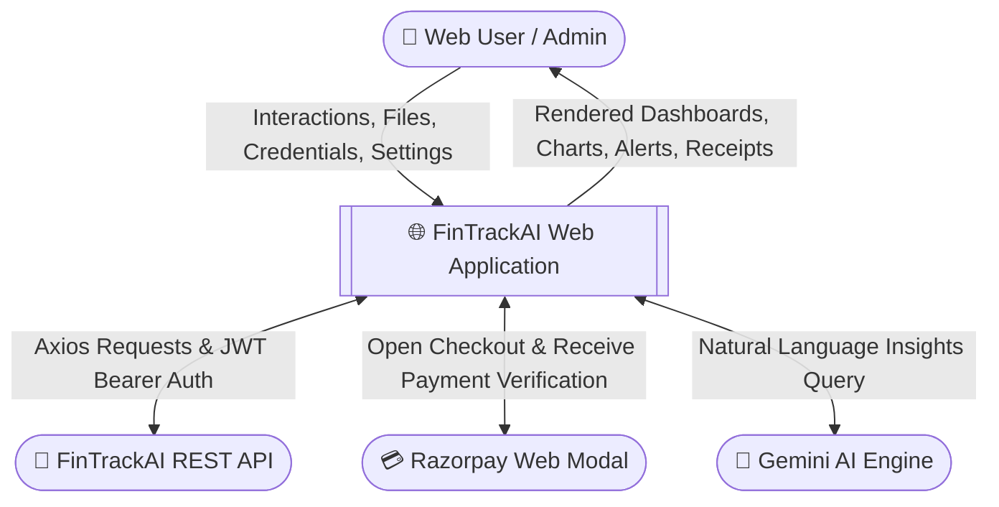
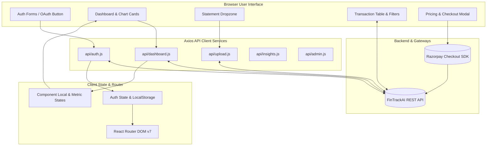
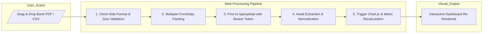

<div align="center">

# 🌐 FinTrackAI - Web Client (React 19 + Vite)
### High-Performance Interactive Financial Intelligence Portal

[](https://react.dev/)
[](https://vitejs.dev/)
[](https://tailwindcss.com/)
[](https://greensock.com/gsap/)
[](https://www.chartjs.org/)

<p align="center">
  <b>The modern web experience for FinTrackAI.</b><br/>
  Featuring reactive financial dashboards, drag-and-drop statement ingestion, dynamic Chart.js visualizations, GSAP micro-animations, Razorpay checkout modals, and a comprehensive admin management console.
</p>

</div>

---

## ✨ Interface Highlights

- 💎 **Ultra-Smooth UI/UX**: Built with Tailwind CSS v4 and fluid scroll animations powered by GSAP.
- 📊 **Dynamic Financial Visualizations**: Real-time spending breakdowns, doughnut charts, and cash-flow trends.
- 📂 **Smart Statement Ingestion**: Instant drag-and-drop support for PDF and CSV bank statements.
- 🤖 **Predictive AI Insights**: Integrated prompts requesting personalized advice via Google Gemini.
- 💳 **In-App Razorpay Checkout**: One-click subscription tier upgrades with automatic session updates.

---

## 🗺️ Web Client Data Flow Diagrams (DFD)

### Level 0 DFD: Web Client Boundary



---

### Level 1 DFD: Internal React Architecture & State Flow



---

### Level 2 DFD: Client Document Upload & Live Chart Update Subsystem



---

## 🛠️ Tech Stack & Dependencies

| Tool | Version | Description |
| :--- | :--- | :--- |
| **Framework** | React `19.1.0` | Core UI library |
| **Bundler** | Vite `7.0.3` | Ultra-fast HMR and build pipeline |
| **Styling** | Tailwind CSS `v4.1.x` | Modern utility-first CSS |
| **Animations** | GSAP `3.13.x` | Timeline and tween animations |
| **Visuals** | Chart.js `4.5.x` | High-DPI canvas charts and legends |
| **Routing** | React Router DOM `7.6.x` | Client-side routing with protected view wrappers |
| **HTTP Client** | Axios `1.7.x` | Network requests with interceptors |

---

## 📁 Directory Structure

```
web/
├── public/                 # Favicons, logos, static illustrations
├── src/
│   ├── api/                # API client modules (auth, dashboard, upload, admin)
│   ├── assets/             # Media and SVGs
│   ├── Authentication/     # Login, Signup, OAuth success redirects
│   ├── components/         # Navbar, Footer, Modals, StatCards, Charts
│   ├── pages/              # Landing, Dashboard, Transactions, Ingestion, Admin
│   ├── App.jsx             # Route definitions and layout wrappers
│   └── main.jsx            # React root mount
├── package.json
└── vite.config.js
```

---

## ⚡ Quick Start

```bash
cd web
npm install

# Start Vite dev server
npm run dev
```

*Open `http://localhost:5173` in your browser.*
